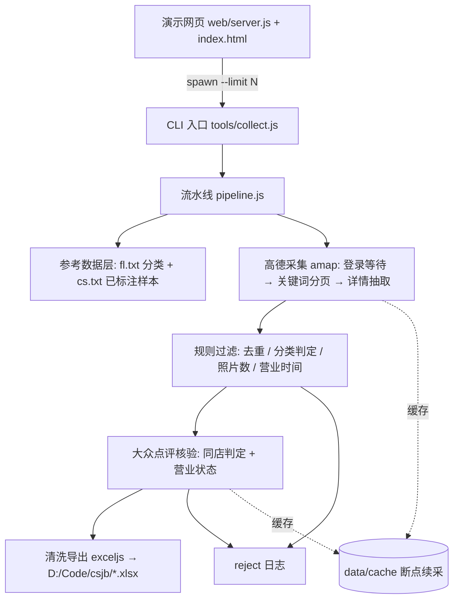

## 产品概述
一个在 Windows 本机运行的“北京休闲娱乐场所”批量采集工具，包含一个可直接运行的命令行脚本和一个演示网页。工具以可见浏览器驱动高德地图（ditu.amap.com）按分类关键词分页采集场所，再按业务规则过滤、去大众点评核验同店存在与营业状态，最终清洗去重后输出一份 21 列的 xlsx 表格到 `D:\Code\csjb`。全程需人工登录（高德、大众点评），每个浏览器操作间隔 2 秒。

## 核心功能
1. **登录等待**：打开高德/大众点评后先等待用户在浏览器中完成登录，检测到已登录再自动继续（登录态本地持久化，下次无需重登）。
2. **高德批量采集**：读取 `fl.txt` 的 12 个分类，用对应关键词（KTV、台球、足疗按摩、剧本杀、网咖电竞、私人影院、棋牌、酒吧、夜店、LiveHouse 等）在全北京（city=110000）逐个搜索并翻页，逐条打开场所详情卡，抓取名称、详细地址（含城市/区县）、评分、人均消费、营业状态与营业时间、联系电话、标签、经纬度、高德场所 ID，以及**封面图右下角“照片N”里的照片数量**（不使用未登录只显示 3 张的相册数字）。
3. **规则过滤（须全部满足）**：
   - 名称不与 `cs.txt` 中 662 条已有场所重复（归一化后比对），且本次结果内部去重；
   - 分类必须落在 `fl.txt` 的 12 个分类内，判定方式参考 `cs.txt` 已有场所的名称规律（含“台球/棋牌”等混合名的优先级），判定不出的丢弃并记入日志；
   - 照片数量 > 5；
   - 非倒闭/关门/歇业/暂停营业，且**结束营业时间晚于 23:00**（兼容 24:00、次日 01:00、24 小时营业等写法）。
4. **大众点评核验**：以 `dianping.com/beijing` 搜索该场所名称，名称不一致时通过地址比对判断同店（门牌号+道路一致，或用高德反查地址中的地标建筑名再对比，如“中国文化大厦”对应“红莲南路57号”）；**“休息中”视为正常营业**，只有歇业/关闭/查不到才不通过。
5. **清洗与导出**：一行一个场所，按列输出到 `D:\Code\csjb` 下的 xlsx，列顺序为：城市、区县、场所名称、详细地址、场所类型（中文名）、纬度、经度、联系电话、微信号、营业时间、封面图（留空）、人均消费、评分、描述、设施标签、特色标签、来源、来源 ID、是否推荐、排序权重，**最后一列为照片数量**；被过滤/被拒绝的条目另存为可复核的日志文件。
6. **演示网页**：一个数字输入框 + 一个按钮，输入数字作为本次采集数量上限，点击后启动采集，页面实时显示日志、进度（已采集/已通过/已过滤）、当前阶段（等待登录/采集中/核验中/导出中）与最终表格路径。


## 技术选型
- 运行时：**Node.js 24（本机已装 v24.19.0 / npm 11.17.0）**。理由：Python 为 3.14.7，playwright-python 对该版本兼容性存在风险，而 Playwright(JS) 在 Node 24 上成熟稳定，且采集、服务、xlsx 生成可统一在一套依赖内完成。
- 浏览器自动化：**Playwright（JS）**，使用 `launchPersistentContext` 持久化用户目录保存登录态；默认 `headless: false`（必须可见，供手动登录/过验证码），优先 `channel: 'chrome'` 使用本机 Chrome，缺失时回退 Playwright 自带 chromium（`npx playwright install chromium`）。
- 本地服务与页面：**Express + 原生 HTML/CSS/JS 单页**（无构建步骤），通过 SSE 推送实时日志；子进程方式启动采集，避免阻塞服务并便于停止。
- Excel 导出：**exceljs**（纯 JS，无需 Python；已确认本机装有 openpyxl 但方案不依赖它）。
- 依赖清单（package.json）：`playwright`、`express`、`exceljs`。安装步骤写入 README：`npm install` + 首次 `npx playwright install chromium`（用系统 Chrome 时可跳过）。

## 实现方案
**总体策略**：单进程流水线 `采集 → 规则过滤 → 点评核验 → 清洗导出`，浏览器只开一个持久化上下文、三个标签页（高德 / 大众点评 / 预留），所有落地数据先写本地缓存，最后一次性汇总导出。选择“DOM + 接口响应双通道取数”而非纯 DOM 或纯接口：DOM 保证与用户看到的内容一致（照片数、营业时间只在详情卡上），接口响应补齐详情卡没有的经纬度与 POI ID，并可作为列表批量初筛的加速来源。

**关键决策与权衡**：
1. **先用接口/列表批量初筛，再点详情**：列表与搜索接口一次可返回多条 POI 的名称、地址、坐标、类型，先用它们完成“与 cs.txt 去重、分类判定、内部去重”，只对通过初筛的场所打开详情卡读取照片数/营业时间/电话/标签。这样把昂贵的详情点击次数降到最低——这一点很关键，因为“每步间隔 2 秒”是硬约束，单条详情的操作次数直接决定总耗时。
2. **分类判定基于样本学习 + 规则优先级**：从 `cs.txt` 的 662 条已标注样本（ktv 148 / TQG 134 / jiuba 65 / JBS 62 / XXAMZY 61 / ZJYX 57 / SRYY 35 / JNJB 32 / QIPAI 26 / LiveHouse 24 / YD 15 / MAJIANG 3）提炼关键词字典与优先级（如“台球”优先 TQG、“棋牌”优先 QIPAI、“精酿”优先 JNJB、“bar/酒吧”归 jiuba、“live/音乐现场”归 LiveHouse），并以高德自身分类字段兜底；同时把 662 条样本作为**回归自测集**（工具内提供 `npm run test:classifier`，输出分类准确率，目标 ≥ 90%），用可量化指标代替“凭感觉调规则”。分类字典在运行时读取 `fl.txt`，分类变动自动同步。
3. **跨平台同店判定分级策略**：先看归一化名称是否包含相同的“核心品牌词 + 门店后缀”；不匹配时做地址比对（同门牌号+同道路）；仍不确定再用用户给出的地标法——提取点评地址中的建筑名，去高德反查该建筑地址，与高德 POI 地址比对。地标反查较贵，只在歧义样本上触发，控制总耗时。
4. **反爬与人工介入**：可见浏览器 + 持久化登录态 + 自动化特征削弱（去掉 `--disable-blink-features=AutomationControlled`、伪造 `navigator.webdriver`、固定语言时区）；遇到验证码/滑块时**暂停并提示**（网页按钮或终端回车继续），不硬刚、不绕验证码。
5. **断点续采**：每条 POI 结果落盘 `data/cache/`，重跑自动跳过已完成项，避免反爬被触发时前功尽弃。
6. **不改动输入文件**：`cs.txt`、`fl.txt` 只读解析；`cs.txt` 是 7 段连续 JSON 拼接（不能直接 `json.load`），必须用循环 `raw_decode`/括号配平方式解析，此处是已知坑点。

**性能与可靠性**：
- 时间下界由 2 秒节流决定：单条通过初筛的场所约 3 次浏览器操作（≥6s）用于详情，点评核验约 5 次操作（≥10s），合计约 16s/条；因此 `--limit N` 的总耗时约 `N × 16s` 加列表翻页开销，CLI 启动时打印预估时间，网页同步展示。
- 复杂度：去重比对用哈希集合（归一化名 O(1) 查表），地址相似度用轻量分词/关键词集合而非 O(n²) 两两比对；点评核验结果按“场所名 → 核验结论”缓存，避免重复访问。
- 稳定性：单条失败不中断整体（try/catch + 写入 reject 日志）；翻页/详情选择器失败时降级到接口响应数据并记录告警；日志分级（INFO/WAIT/REJECT/ERROR），不打印手机号等敏感字段全文。

## 实现注意事项
- **选择器必须先侦察再固化**：高德列表项、详情卡、“照片N”、大众点评搜索结果项的 DOM 结构与内部接口路径不能凭想象编写，实现时先用 [skill:playwright-cli] 实际打开页面采集 DOM/接口样本，再落地选择器，并保留多套兜底选择器。
- **照片数只认封面右下角“照片N”**：相册区“共 N 张”在未登录时会失真的情况需在代码注释与 README 中标注，防止后续误改。
- **营业时间解析**：结束时间早于开始时间视为跨天（`+24h`）；`24:00` 记为 1440；`24小时营业/全天营业` 直接通过；比较阈值 23:00（1380 分钟），阈值与延时均做成配置项（默认 2000ms）。
- **节流统一入口**：所有浏览器动作（导航、输入、点击、滚动、切页）都经由一个 `pace()` 函数前置等待，避免遗漏某处操作。
- **不影响其他文件**：仅新增目录与文件，不修改 `cs.txt`/`fl.txt`；输出文件带时间戳，不覆盖历史结果。

## 架构设计


## 目录结构
```
d:/Code/csjb/
├── package.json                      # [NEW] 依赖与脚本(collect/web/test:classifier)，Node + playwright/express/exceljs
├── README.md                         # [NEW] 安装步骤、登录指引、参数说明、输出文件说明、常见问题(验证码/未登录照片数)
├── config/
│   ├── categories.json               # [NEW] fl.txt 的 12 分类：code/中文名/高德搜索关键词/分类优先级
│   └── rules.json                    # [NEW] 默认节流 2000ms、照片数下限 5、营业结束阈值 23:00、设施/特色标签关键词表
├── src/
│   ├── config.js                     # [NEW] 统一读取配置与命令行参数(路径、延时、上限、开关)
│   ├── logger.js                     # [NEW] 分级日志(INFO/WAIT/REJECT/ERROR)，写文件并广播事件供网页 SSE 展示
│   ├── pace.js                       # [NEW] 全局节流：所有浏览器动作前置等待(默认 2000ms)
│   ├── data/reference.js             # [NEW] 解析 fl.txt 与 7 段拼接的 cs.txt(循环 raw_decode)，输出分类字典、已有名称集合、662 条标注样本
│   ├── data/classifier.js            # [NEW] 基于样本关键词+高德分类字段的场所分类判定，返回中文分类名或“无法判定”
│   ├── clean/normalize.js            # [NEW] 名称/地址归一化(去“(xx店)”分店后缀、全半角、大小写、标点、空白)
│   ├── clean/businessHours.js        # [NEW] 营业时间解析(11:00-24:00 / 12:00-次日05:00 / 24小时)与结束时间判定
│   ├── clean/dedupe.js               # [NEW] 与 cs.txt 已有名称比对 + 本次内部去重 + 字段清洗
│   ├── amap/browser.js               # [NEW] 持久化可见浏览器启动、登录等待与检测、验证码暂停机制
│   ├── amap/collector.js             # [NEW] 按分类关键词搜索并翻页，响应拦截收集候选 POI，按上限控制数量
│   ├── amap/detail.js                # [NEW] 打开详情卡抽取名称/地址/评分/人均/电话/标签/营业时间/照片数/经纬度/POI ID
│   ├── dianping/verify.js            # [NEW] 大众点评登录等待、按名称搜索、名称+地址+地标反查的同店判定、营业状态判定(休息中算通过)
│   ├── export/xlsx.js                # [NEW] exceljs 输出 21 列表格(冻结首行、列宽、营业时间等文本列防格式转换)
│   ├── report.js                     # [NEW] 被过滤/被拒绝条目日志(名称、来源、原因、原始字段)导出 csv/json
│   └── pipeline.js                   # [NEW] 编排：采集→过滤→核验→清洗→导出，维护统计与断点缓存
├── tools/collect.js                  # [NEW] CLI 入口：--limit/--categories/--delay/--skip-verify/--resume/--out
├── test/
│   ├── classifier.test.js            # [NEW] 用 cs.txt 662 条样本回归自测分类准确率
│   └── businessHours.test.js         # [NEW] 营业时间解析与 23:00 阈值用例(含跨天/24小时/异常)
└── web/
    ├── server.js                     # [NEW] Express：静态页、POST /api/start(limit)、GET /api/stream(SSE)、/api/stop、/api/status
    └── public/index.html             # [NEW] 演示页：数字输入框+开始按钮+实时日志+进度+结果路径(深色控制台风格)
```

## 关键代码结构
```js
// 输出表格列顺序（固定契约，export/xlsx.js 与 pipeline.js 共用）
const COLUMNS = [
  '城市','区县','场所名称','详细地址','场所类型','纬度','经度','联系电话','微信号',
  '营业时间','封面图','人均消费','评分','描述','设施标签','特色标签','来源','来源 ID',
  '是否推荐','排序权重','照片数量'
];

// config/categories.json 单条分类配置（分类判定与关键词搜索共用）
// { "code": "TQG", "name": "台球馆", "keywords": ["台球","台球厅","桌球","乔氏"],
//   "amapQuery": "台球", "priority": 20 }
```


## 设计风格
演示页定位为“数据采集控制台”，采用深色玻璃拟态 + 科技蓝青渐变的现代风格，营造专业、可信、运行中“有生命感”的氛围。单页无构建，由 Express 托管静态页面，原生 HTML/CSS/JS + SSE 实现实时数据流动。

## 页面规划（单屏一页，含 5 个区块）
1. **顶部标题栏**：左侧工具名与副标题“高德地图 · 北京休闲娱乐场所批量采集”，右侧运行状态徽标（空闲 / 等待登录 / 采集中 / 核验中 / 导出中），徽标带呼吸动画。
2. **操作卡（核心）**：大号数字输入框（标签“采集数量上限”，单位“个”，聚焦时青色光晕）+ 主按钮“开始采集”，按钮下方显示预估耗时提示与当前配置摘要（延时 2 秒 / 照片数 >5 / 结束营业 > 23:00 / 点评核验开启）。
3. **进度卡**：横向渐变进度条 + 四个指标块（已采集 / 已通过 / 已过滤 / 已核验），数字变化时轻微上浮动画，右上角显示结果文件路径与“打开目录”按钮。
4. **实时日志终端**：等宽字体深色终端面板，自动滚动；不同级别着色（普通灰白、等待登录高亮青、被过滤橙、错误红），顶部提供“自动滚动 / 清空”开关。
5. **底部状态条与提示**：显示当前阶段说明（如“请在已打开的浏览器窗口中完成高德登录，登录后自动继续”）与手动介入按钮（“我已登录”“继续”）。

## 交互与响应
- 点击“开始采集”：校验输入为正整数 → 按钮进入 loading 并禁用 → 建立 SSE 连接接收日志与进度 → 任务进行中显示“停止采集”。
- 页面同时打开高德/大众点评浏览器窗口时，网页与浏览器协同：网页只做控制与展示，不阻塞用户手动登录/过验证码。
- 响应式：桌面优先（≥1200px 三卡区并排，日志面板固定高度独立滚动）；窄屏自动单列堆叠，操作卡置顶。
- 微动效：卡片悬停微抬升与边框提亮、按钮渐变滑动高光、日志新行渐入、完成时进度条扫光并弹出成功 toast。


## Agent Extensions
### Skill
- **playwright-cli**
  - Purpose: 在实现采集模块前，真实打开高德地图与大众点评页面，侦察并验证列表项、详情卡、“照片N”数字、点评搜索结果项的真实 DOM 结构与内部接口路径，并验证登录等待与 2 秒节流流程。
  - Expected outcome: 得到可复用的、经实测确认的选择器与接口样本，写入 `src/amap/*`、`src/dianping/*`，杜绝臆造选择器导致的返工。
- **xlsx**
  - Purpose: 规范最终导出的 xlsx 文件格式，确保 21 列顺序正确、首行冻结、列宽可读、营业时间/电话/经纬度等列按文本导出而不被 Excel 误转格式。
  - Expected outcome: 生成可直接打开、可直接对照录入表单填写的 `场所采集_时间戳.xlsx`，无科学计数法与日期错乱问题。
